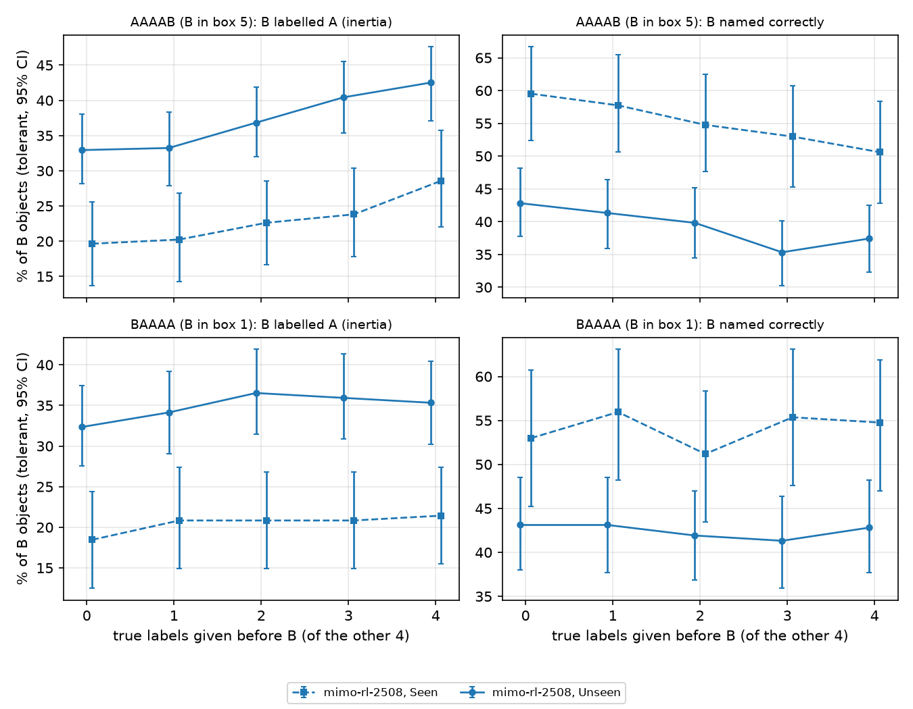

# Runs of mimo-rl-2508 (MiMo-VL-7B-RL-2508)

Xingjian Liu's runs of MiMo-VL-7B-RL-2508 (`mimo-rl-2508`). This folder holds result data only. The RQ1 and core forcing runs use the team harness on `main` at `52429fe`. The finer forcing runs use commits on branch `rq2/forcing-probes`, named in their section.

This folder has four runs:

- The finished RQ1 run on all 5,163 ROPE items, with both probes: `default` (all five boxes in one answer) and `single` (one box per call). Decoding is greedy. Split `train` is Seen and `validation` is Unseen.
- The core RQ2 forcing runs on Adversarial (`AAAAB`, `BAAAA`): one-shot teacher forcing, moh's incremental teacher forcing, and the counterfactual prefix (section "RQ2 forcing probes").
- The finer RQ2 forcing runs: labels given 0–3 (dose-response, Figure 4), labels written as the start of the model's answer (placement), the Homogeneous control, and C near / far (section "RQ2 finer forcing runs").
- A smoke run on part of Unseen, made before the full run (last section).

## Files of the RQ1 run

| file | contents | rows | size |
|---|---|---|---|
| `rq1_mimo-rl-2508_default_train.jsonl` | default, Seen, subsets `heterogenous` `homogenous` `mixed` | 2,251 | 34.2 MB |
| `rq1_mimo-rl-2508_default_validation.jsonl` | default, Unseen, the same three subsets | 1,908 | 35.1 MB |
| `rq1_mimo-rl-2508_single_train.jsonl` | single, Seen, the same three subsets | 2,251 | 19.0 MB |
| `rq1_mimo-rl-2508_single_validation.jsonl` | single, Unseen, the same three subsets | 1,908 | 18.2 MB |
| `rq1_mimo-rl-2508_adversarial_default_train.jsonl` | default, Seen, `AAAAB` `BAAAA` | 336 | 3.6 MB |
| `rq1_mimo-rl-2508_adversarial_default_validation.jsonl` | default, Unseen, `AAAAB` `BAAAA` | 668 | 9.5 MB |
| `rq1_mimo-rl-2508_adversarial_single_train.jsonl` | single, Seen, `AAAAB` `BAAAA` | 336 | 2.4 MB |
| `rq1_mimo-rl-2508_adversarial_single_validation.jsonl` | single, Unseen, `AAAAB` `BAAAA` | 668 | 6.3 MB |
| `rq1_table1.csv` | Table 1, one line per subset x probe x split | 24 | |
| `rq1_fig1_position.png` | accuracy by box position (Figure 1) | | |
| `rq1_parser_audit.jsonl` | hand check of 100 rows: key, verdict, note | 100 | |
| `rq1_tables.md` | full output of `analysis/rq1_table.py` on these files: Table 1, paired tests, box positions, Seen vs Unseen | | |

The file layout, subset names, row schema and paths are the same as in `results/qwen3vl-8b-instruct/`:

- Subset names follow moh's folder names: `mixed` is In-the-Wild, `homogenous` is Homogeneous and `heterogenous` is Heterogeneous. Adversarial is `AAAAB` plus `BAAAA` (502 images, each in both orders).
- Rows follow the JSONL schema in `harness/README.md`. `raw_output` keeps the full thinking trace.
- `image_path` and `model_path` are relative to `$CSE595_ROOT`.

The tables, CSV and figure come from:

```bash
source harness/env.sh
python analysis/rq1_table.py --out-dir results/mimo-rl-2508 results/mimo-rl-2508/rq1_*.jsonl
```

## How the RQ1 runs were made

All jobs ran on Great Lakes under account `cse595f26_class`, on one A40 each (partition `spgpu`, `max_model_len` 12288, GPU memory utilization 0.85).

| setting | value |
|---|---|
| vLLM | 0.11.0 |
| transformers | 4.57.6 |
| torch | 2.8.0 |
| model revision | `ec4ebdc29b83b94aa7f62670c78376250dad8dbc` |
| `max_tokens` | 8192 (`configs/models.yaml`) |

Each job ran `harness/scripts/run.sbatch` on all five subsets of one split. That script calls the following, with `--prefix-caching off` added for `single`:

```bash
python -m rope_runner.run --model mimo-rl-2508 --probe <probe> --split <split> --greedy --chunk 128 --out <file> --resume
```

The runner wrote one file per probe and split. The eight files here are those four files split into the three main subsets and Adversarial.

| job | probe | split | elapsed |
|---|---|---|---|
| 65890397 | default | Unseen | 3:25:43 |
| 65890399 | single | Unseen | 2:20:05 |
| 65890403 | default | Seen | 2:58:24 |
| 65890405 | single | Seen | 2:15:29 |

Each file finished within its first job. The class account stops every job after 4 hours, so each run also had standby jobs queued to continue it with `--resume`. Since every run had already finished, those jobs (65890398, 65890400–65890402, 65890404, 65890406–65890408) found nothing left to do and exited within 12 s.

This command reproduces a run (here single on Seen; change `SPLIT`, `PROBES` and the flags for the others):

```bash
sbatch -A "$CSE595_ACCOUNT" -o "$CSE595_LOGS/%x-%j.out" -e "$CSE595_LOGS/%x-%j.err" \
  --export=ALL,MODEL=mimo-rl-2508,SPLIT=train,PROBES=single,EXTRA="--chunk 128 --prefix-caching off",OUT=$CSE595_RUNS/rq1_mimo-rl-2508_single_train.jsonl \
  harness/scripts/run.sbatch
```

## Integrity

Every file has exactly one row per entry of the ROPE JSON for its subset and split. There are no duplicate keys and no broken lines.

| split | heterogenous | homogenous | mixed | AAAAB | BAAAA |
|---|---|---|---|---|---|
| Seen | 312 | 400 | 1,539 | 168 | 168 |
| Unseen | 246 | 490 | 1,172 | 334 | 334 |

### Calls that hit the 8,192-token limit

| probe | split | calls | at the limit | median thinking tokens | 90th percentile |
|---|---|---|---|---|---|
| default | Seen | 2,587 | 291 (11.2%) | 660 | 8,192 |
| default | Unseen | 2,576 | 347 (13.5%) | 949 | 8,192 |
| single | Seen | 12,935 | 129 (1.0%) | 50 | 152 |
| single | Unseen | 12,880 | 158 (1.2%) | 55 | 232 |

Most cut `default` traces end in a loop. In 248 of 291 (Seen) and 250 of 347 (Unseen), the same sentences repeat over and over in the last 4,000 characters. The rest keep going back and forth ("Wait, no, ...") until they hit the limit.

## Scoring

Scoring follows the Qwen3-VL-8B-Instruct README:

- **Parsers.** The tolerant parse gives the main number, and strict (moh's official parser) is shown beside it.
- **Token limit.** A call that hits the token limit makes every object it answers wrong. Those objects stay in the denominator.
- **Accuracy and CIs.** Accuracy is correct boxes over scored boxes. CIs are 95% percentile bootstraps over images (2,000 reps).
- **"Cut rows dropped".** This column drops every row with a call at the limit. It is shown as a check on the token-limit rule.

## Table 1: per-object accuracy (%)

| subset | probe | split | n images | n objects | calls at limit | tolerant [95% CI] | strict [95% CI] | tolerant, cut rows dropped |
|---|---|---|---|---|---|---|---|---|
| In-the-Wild | default | Seen | 1,539 | 7,695 | 195 | 60.6 [59.0, 62.3] | 55.7 [53.9, 57.4] | 69.4 |
| In-the-Wild | default | Unseen | 1,172 | 5,860 | 211 | 53.3 [51.5, 55.3] | 46.3 [44.2, 48.4] | 65.1 |
| In-the-Wild | single | Seen | 1,539 | 7,695 | 79 | 69.8 [68.6, 71.0] | 52.9 [51.5, 54.3] | 70.7 |
| In-the-Wild | single | Unseen | 1,172 | 5,860 | 80 | 64.9 [63.5, 66.3] | 47.0 [45.5, 48.7] | 65.7 |
| Homogeneous | default | Seen | 400 | 2,000 | 7 | 87.0 [84.0, 90.0] | 85.2 [81.6, 88.3] | 88.5 |
| Homogeneous | default | Unseen | 490 | 2,450 | 22 | 79.8 [76.6, 82.8] | 78.0 [74.6, 81.3] | 83.5 |
| Homogeneous | single | Seen | 400 | 2,000 | 5 | 88.2 [85.8, 90.5] | 73.7 [70.5, 76.8] | 88.4 |
| Homogeneous | single | Unseen | 490 | 2,450 | 16 | 79.7 [77.0, 82.5] | 64.4 [61.3, 67.5] | 81.6 |
| Heterogeneous | default | Seen | 312 | 1,560 | 68 | 48.1 [44.5, 51.8] | 45.4 [41.6, 49.5] | 61.6 |
| Heterogeneous | default | Unseen | 246 | 1,230 | 57 | 41.5 [37.7, 45.3] | 35.4 [31.4, 39.4] | 54.0 |
| Heterogeneous | single | Seen | 312 | 1,560 | 33 | 61.8 [59.5, 64.2] | 41.7 [39.2, 44.4] | 63.3 |
| Heterogeneous | single | Unseen | 246 | 1,230 | 23 | 53.0 [50.5, 55.4] | 32.8 [30.2, 35.5] | 53.8 |
| Adversarial | default | Seen | 336 | 1,680 | 21 | 70.2 [66.4, 73.9] | 67.9 [64.2, 71.8] | 74.9 |
| Adversarial | default | Unseen | 668 | 3,340 | 57 | 65.1 [62.3, 67.8] | 60.6 [57.8, 63.4] | 71.2 |
| Adversarial | single | Seen | 336 | 1,680 | 12 | 77.5 [74.6, 80.3] | 63.9 [60.7, 67.0] | 78.2 |
| Adversarial | single | Unseen | 668 | 3,340 | 39 | 68.1 [65.9, 70.2] | 52.2 [49.8, 54.6] | 70.2 |

`rq1_tables.md` also has the AAAAB and BAAAA rows separately.

## Single vs default on the same images

The comparison is paired by image and box: diff = default − single, in points. The method (McNemar and the paired bootstrap) is the same as in the Qwen3-VL-8B-Instruct README. The last column comes without a CI or test.

| subset | split | tolerant single -> default | diff [95% CI] | Holm p | strict diff | tolerant diff, cut rows dropped |
|---|---|---|---|---|---|---|
| In-the-Wild | Seen | 69.8 -> 60.6 | -9.1 [-10.5, -7.8] | 8.0e-76 | +2.8 | -2.3 |
| In-the-Wild | Unseen | 64.9 -> 53.3 | -11.6 [-13.2, -9.9] | 1.9e-76 | -0.7 | -1.9 |
| Homogeneous | Seen | 88.2 -> 87.0 | -1.2 [-3.2, +0.6] | 0.127 | +11.4 | +0.1 |
| Homogeneous | Unseen | 79.7 -> 79.8 | +0.1 [-1.8, +2.0] | 0.951 | +13.6 | +2.2 |
| Heterogeneous | Seen | 61.8 -> 48.1 | -13.7 [-17.0, -10.4] | 3.1e-29 | +3.7 | -2.1 |
| Heterogeneous | Unseen | 53.0 -> 41.5 | -11.5 [-14.6, -8.4] | 2.6e-18 | +2.5 | -0.9 |
| Adversarial | Seen | 77.5 -> 70.2 | -7.3 [-9.9, -4.5] | 8.1e-14 | +3.9 | -3.5 |
| Adversarial | Unseen | 68.1 -> 65.1 | -2.9 [-4.9, -1.0] | 2.0e-04 | +8.4 | +2.0 |

## Seen vs Unseen

Every cell is lower on Unseen, by 4.8 to 9.4 points under the tolerant parse (Holm p ≤ 0.03 for all eight rows; see section (d) of `rq1_tables.md`).

## Parser audit

We drew 100 rows of the eight RQ1 files and read every answer. The draw used seed 0 and took 5 rows from each probe x split x subset cell, so it covers 500 objects. `rq1_parser_audit.jsonl` has the verdict for each row.

| check | rows | Wilson 95% |
|---|---|---|
| tolerant label differs from what the answer says | 0 / 100 (0 / 500 objects) | 0.0 to 3.7% (objects: 0.0 to 0.8%) |
| the answer names a class outside the candidate list | 0 / 100 | 0.0 to 3.7% |
| default: strict fails only because of the answer's format | 6 / 50 | 5.6 to 23.8% |
| single: strict fails only because of the answer's format (calls answered `\boxed{class}`) | 33 / 50 (78 / 250 calls) | 52.2 to 77.6% (calls: 25.8 to 37.2%) |
| default: the call hit the token limit (no answer) | 5 / 50 | |

The six default format failures have two causes:

- **`\boxed{...}` wrapper (4 rows).** The answer is wrapped in `\boxed{obj1: ..., obj5: ...}`. Strict keeps the closing brace on box 5 (`person}`), so only that box is lost.
- **Explanation before the answer (2 rows).** The answer is a markdown explanation that ends in a boxed list. Strict reads nothing there.

## Notes for the team

1. **Under tolerant scoring, default loses to single mostly through the token limit.**
   - Default calls hit the 8,192-token limit 11–14% of the time; single calls about 1%.
   - Under the tolerant parse, default is 9–14 points below single on In-the-Wild and Heterogeneous.
   - When rows with a cut call are dropped, that gap shrinks to about 1–2 points.
   - So for MiMo-RL, most of default's loss is thinking that runs away on the five-box prompt, not wrong labels. The RQ1 write-up should show both columns.
2. **Strict on `single` mostly measures a format habit.**
   - In `single`, MiMo-RL often answers `\boxed{class}`. The strict parser reads that as an off-list label.
   - This happens on 3,528 of 12,935 Seen and 4,082 of 12,880 Unseen single answers.
   - So strict `single` is 14–20 points below tolerant. This is why strict says default beats single (strict diff column) while tolerant says the opposite.
3. **The odd box B is harder under both probes, and more so under default.**
   - On Unseen AAAAB, box 5 (B) gets 42.2% under default and 57.2% under single. Boxes 1–4 get 68–73% under both probes.
   - On Unseen BAAAA, box 1 (B) gets 44.6% under default and 54.2% under single.
   - Seen shows the same pattern with smaller gaps: AAAAB 56.5 vs 63.7, BAAAA 51.8 vs 58.9.
   - The drop under default also appears in BAAAA, where B is the first box the model labels.
   - These position numbers are descriptive and not tested here. The forcing probes (Table 4) pair them.

## RQ2 forcing probes

### Files

| file | contents | rows | calls | at the limit | size |
|---|---|---|---|---|---|
| `forcing_mimo-rl-2508_tf-oneshot_train.jsonl` | one-shot teacher forcing, Seen, `AAAAB` `BAAAA` | 336 | 336 | 8 (2.4%) | 2.6 MB |
| `forcing_mimo-rl-2508_tf-oneshot_validation.jsonl` | one-shot teacher forcing, Unseen | 668 | 668 | 30 (4.5%) | 6.8 MB |
| `forcing_mimo-rl-2508_tf-incremental_train.jsonl` | incremental teacher forcing (moh), Seen | 336 | 1,680 | 74 (4.4%) | 15.1 MB |
| `forcing_mimo-rl-2508_tf-incremental_validation.jsonl` | incremental teacher forcing (moh), Unseen | 668 | 3,340 | 244 (7.3%) | 40.7 MB |
| `forcing_mimo-rl-2508_cf_train.jsonl` | counterfactual prefix, Seen | 336 | 336 | 18 (5.4%) | 3.5 MB |
| `forcing_mimo-rl-2508_cf_validation.jsonl` | counterfactual prefix, Unseen | 668 | 668 | 50 (7.5%) | 8.4 MB |
| `forcing_table4.csv` | Table 4 with CIs, p-values, the uncut check and the comparison with single, one line per model x split x order x condition (core and finer runs) | 84 | | | |
| `forcing_tables.md` | full output of `analysis/forcing_table.py` on the RQ1 files and every forcing file here (core and finer) | | | | |
| `forcing_parser_audit.jsonl` | hand check of 48 rows: key, verdict, note | 48 | | | |

Every row asks about the odd object B (box 5 in `AAAAB`, box 1 in `BAAAA`). Each probe puts labels for the other four boxes in the user turn, then asks for B:

- **TF one-shot.** The four true labels (all A) are given, and the model is asked for B in one call. In `BAAAA` the prompt lists `obj2`–`obj5` first and asks `obj1:` last, so B is asked last in both orders.
- **TF incremental.** This is moh's official teacher forcing. Call k gives the true labels of boxes 1..k−1 and asks box k (5 calls per image). In `BAAAA`, B is box 1, so it is asked in call 1 with nothing given. That makes `BAAAA` incremental a no-forcing control.
- **CF (counterfactual).** The four other boxes are given a wrong class C instead of A. C is drawn per image with seed 0 from the split's candidate list, leaving out every class in the image's `object_set`.

### How the forcing runs were made

The settings are the same as for the RQ1 runs (A40, vLLM 0.11.0, revision `ec4ebdc…`, `max_tokens` 8192, greedy). The code is the team harness on `main` at `52429fe`.

| job | probes | split | elapsed |
|---|---|---|---|
| 65894186 | TF one-shot + CF | Unseen | 1:15:49 |
| 65894188 | TF incremental | Unseen | 2:28:30 |
| 65894190 | TF one-shot + CF | Seen | 0:35:55 |
| 65894192 | TF incremental | Seen | 0:52:40 |

Each run finished within its first job. The standby jobs 65894187, 65894189, 65894191 and 65894193 found nothing left and exited within 8 s. The runner wrote one file per split for TF one-shot + CF and one for incremental. The six files here are those files split by probe, so each stays under GitHub's 50 MB warning.

```bash
sbatch -A "$CSE595_ACCOUNT" -o "$CSE595_LOGS/%x-%j.out" -e "$CSE595_LOGS/%x-%j.err" \
  --export=ALL,MODEL=mimo-rl-2508,SPLIT=validation,PROBES="teacher_forcing counterfactual",SUBSETS="AAAAB BAAAA",EXTRA="--chunk 128",OUT=$CSE595_RUNS/forcing_mimo-rl-2508_validation.jsonl \
  harness/scripts/run.sbatch
# incremental: PROBES=teacher_forcing, EXTRA="--chunk 128 --tf-mode incremental"
```

**Integrity.** Each probe has exactly one row per ROPE entry in each subset: 168 + 168 Seen, 334 + 334 Unseen. There are no duplicate keys and no broken lines.

### Scoring

Table 4 comes from `analysis/forcing_table.py` on branch `rq2/forcing-probes` (commit `539ccfc`; from that commit each bootstrap CI is seeded by its own values, so loading more conditions no longer moves a CI). It reads the RQ1 files (the full ones give the Homogeneous baseline) and every forcing file in this folder, and writes `forcing_tables.md`, `forcing_table4.csv`, `forcing_fig4_tests.csv` and `forcing_fig4_dose.png`:

```bash
python analysis/forcing_table.py --out-dir results/mimo-rl-2508 \
  results/mimo-rl-2508/rq1_mimo-rl-2508_*.jsonl results/mimo-rl-2508/forcing_mimo-rl-2508_*.jsonl \
  results/mimo-rl-2508/forcing_{dose,place,homog,cfnear,cffar}_mimo-rl-2508_*.jsonl > results/mimo-rl-2508/forcing_tables.md
```

- **Outcomes per B.** Each B is scored three ways: named correctly; labelled A (inertia: the class of the other four); and, for CF, labelled C.
- **Parsers.** The tolerant parse gives the main number. For one-shot rows, the script re-reads strict from the answer by the key `objK`, whatever scorer wrote the row. `main`'s scorer reads by position, which is wrong for `BAAAA`.
- **Tests.** Every condition is compared with `default` on the same images (and, in a second table, with `single`): exact McNemar, then Holm within the probe family. The families are core (single, TF incremental, TF one-shot, CF), dose (given 0–3), placement, C near / far and the Homogeneous control. Each family is one question, so adding a finer run does not change the core p-values below. CIs are bootstraps over images.
- **Token limit.** A call for B that hits the limit makes B wrong and never A, as in RQ1.
- **Uncut check.** `default` is usually cut more often than the forcing probes (57 vs 30 of 668 Unseen images for TF one-shot), and that alone would raise B=A. So every comparison is repeated on the images where neither call for B was cut.

### Table 4 (MiMo-VL-7B-RL-2508): the odd object B (%, tolerant)

"vs default" is the paired difference in B=A in points, with the Holm-corrected p in parentheses. "all" uses every image; "uncut" uses only images where neither call for B hit the limit. The pooled Adversarial rows, strict numbers, CIs and the accuracy comparisons are in `forcing_tables.md`.

| split | order | condition | n | cut | B acc | B=A | B=C | B=A vs default, all | B=A vs default, uncut |
|---|---|---|---|---|---|---|---|---|---|
| Unseen | AAAAB | default | 334 | 35 | 42.2 | 29.3 | | | |
| Unseen | AAAAB | single | 334 | 9 | 57.2 | 18.9 | | −10.5 (2.2e-04) | −11.9 (7.6e-05) |
| Unseen | AAAAB | TF one-shot | 334 | 16 | 37.4 | 42.5 | | **+13.2 (1.4e-06)** | **+11.4 (1.9e-04)** |
| Unseen | AAAAB | TF incremental | 334 | 16 | 38.6 | 40.7 | | **+11.4 (5.9e-05)** | **+10.7 (6.9e-04)** |
| Unseen | AAAAB | CF | 334 | 29 | 39.2 | 35.6 | 0.3 | +6.3 (0.039) | +6.0 (0.084) |
| Unseen | BAAAA | default | 334 | 22 | 44.6 | 32.6 | | | |
| Unseen | BAAAA | single | 334 | 5 | 54.2 | 24.0 | | −8.7 (0.0028) | −9.4 (0.0016) |
| Unseen | BAAAA | TF one-shot | 334 | 14 | 42.8 | 35.3 | | +2.7 (1) | +2.0 (1) |
| Unseen | BAAAA | TF incremental (B asked first) | 334 | 35 | 41.9 | 33.2 | | +0.6 (1) | +1.4 (1) |
| Unseen | BAAAA | CF | 334 | 21 | 42.5 | 35.3 | 0.6 | +2.7 (1) | +3.0 (1) |
| Seen | AAAAB | default | 168 | 9 | 56.5 | 20.8 | | | |
| Seen | AAAAB | single | 168 | 1 | 63.7 | 12.5 | | −8.3 (0.039) | −8.9 (0.021) |
| Seen | AAAAB | TF one-shot | 168 | 5 | 50.6 | 28.6 | | +7.7 (0.24) | +8.4 (0.23) |
| Seen | AAAAB | TF incremental | 168 | 4 | 51.2 | 28.6 | | +7.7 (0.21) | +7.6 (0.29) |
| Seen | AAAAB | CF | 168 | 9 | 50.0 | 23.8 | 1.2 | +3.0 (1) | +3.2 (1) |
| Seen | BAAAA | default | 168 | 12 | 51.8 | 17.9 | | | |
| Seen | BAAAA | single | 168 | 2 | 58.9 | 16.1 | | −1.8 (1) | −3.8 (1) |
| Seen | BAAAA | TF one-shot | 168 | 3 | 54.8 | 21.4 | | +3.6 (1) | +2.6 (1) |
| Seen | BAAAA | TF incremental (B asked first) | 168 | 9 | 53.0 | 20.8 | | +3.0 (1) | +1.3 (1) |
| Seen | BAAAA | CF | 168 | 9 | 51.2 | 22.6 | 0.6 | +4.8 (0.46) | +4.0 (0.56) |

Pooled over both orders on Unseen (uncut), B=A rises by +6.6 under TF one-shot (Holm p 8.6e-04), +6.0 under TF incremental (0.0028) and +4.5 under CF (0.038). B accuracy falls by 4.9 under TF one-shot (0.024).

### What the model writes after the given labels

The model rewrites the whole list. In 99.7–100% of answered rows it gives all five labels `obj1`–`obj5`, not only B. It treats the given labels as follows (section "What the answer does with the given boxes" of `forcing_tables.md`, both orders):

| probe | split | keeps the given labels on all four other boxes | labels those four boxes A |
|---|---|---|---|
| TF one-shot (given = A) | Seen / Unseen | 87.2% / 77.0% | 87.2% / 77.0% |
| CF (given = C) | Seen / Unseen | 0.9% / 0.0% | 74.5% / 64.1% |

Under CF it almost never keeps C: C appears on any of the four boxes in only 5 of 318 Seen and 9 of 618 Unseen answered rows. Instead it relabels them, mostly as A. (An earlier, hand-counted version of this README had 74.1% over 320 Seen rows; the script counts 318 answered Seen rows.)

### Parser audit

48 rows were read by hand: 4 per probe x split x order, drawn with `random.seed(0)`. In all 48 rows, the tolerant label for B equals what the answer gives for B. The one cut row (thinking never closed) is empty under both parsers.

Strict differs from tolerant in 11 rows:

- In 6 rows the answer explains first and ends with `\boxed{obj1: ..., obj5: ...}`, and strict reads nothing.
- In 3 rows the whole answer is wrapped in `\boxed{...}`.
- In 2 rows the list is clean, but moh's incremental scorer had stopped at an earlier call, so it scores B wrong.

The CF answers in the sample all replace C.

### Notes for the team

1. **Forcing the four A labels pulls B toward A when B is box 5.** On Unseen AAAAB, TF one-shot raises B=A from 29.3% to 42.5% (+13.2, Holm p 1.4e-06), and the rise stays at +11.4 on uncut images. Incremental TF gives about the same (+11.4). Seen goes the same way (+7.7 to +8.4) but is not significant after Holm with 168 images.
2. **The pull is weak when B is box 1.** In `BAAAA`, one-shot TF lists the four A labels before asking B, just as in `AAAAB`, yet B=A rises only 2–4 points (not significant). Box order matters, not only the order of labels in the text. `BAAAA` incremental asks B first with nothing given; as a control should, it shows no significant change (+0.6 to +3.0).
3. **The model rejects the counterfactual class but still drifts to A.** B=C is 0.3–1.2%, and the model rewrites the given boxes, mostly as A. B=A still rises under CF (Unseen pooled +4.5 uncut, Holm p 0.038). This fits B being pulled by the model's own relabelling of the other four boxes, which is the self-induced part of RQ2. But CF also changes the question (B is asked after four given labels), so this run alone does not separate the two.
4. **Single stays far ahead of every forcing condition on B.** Forcing lowers pooled B accuracy against default by 1.5–5 points. The default−single gap from RQ1 stays.
5. **Strict is unreliable here, as in RQ1.** Most strict failures are the `\boxed{}` habit or moh's incremental early stop, so read strict as a format measure.
6. **Assistant-turn prefill changed after a test.** In an 8-image test, the model wrote the forced label right after the prefill. It then often wrote "Wait, no, that's wrong" and re-checked the image. The 128-token answer stage cut that re-check. The full assistant-prefill runs therefore give the answer stage the rest of the 8,192-token budget (commit `25a0244` on `rq2/forcing-probes`). Their results are in the next section.

## RQ2 finer forcing runs

### Files

| file | contents | rows | calls | at the limit | size |
|---|---|---|---|---|---|
| `forcing_dose_mimo-rl-2508_train.jsonl` | one-shot TF with only the first n of the four labels given (n = 0–3), Seen, `AAAAB` `BAAAA` | 1,344 | 1,344 | 52 (3.9%) | 12.7 MB |
| `forcing_dose_mimo-rl-2508_validation.jsonl` | the same, Unseen | 2,672 | 2,672 | 195 (7.3%) | 35.3 MB |
| `forcing_place_mimo-rl-2508_train.jsonl` | TF one-shot and CF with the labels written as the start of the model's answer, Seen | 672 | 672 | 49 (7.3%) | 8.4 MB |
| `forcing_place_mimo-rl-2508_validation.jsonl` | the same, Unseen | 1,336 | 1,336 | 151 (11.3%) | 21.9 MB |
| `forcing_homog_mimo-rl-2508_train.jsonl` | one-shot TF on Homogeneous (`homogenous`), Seen | 400 | 400 | 0 | 1.5 MB |
| `forcing_homog_mimo-rl-2508_validation.jsonl` | the same, Unseen | 490 | 490 | 8 (1.6%) | 2.8 MB |
| `forcing_fig4_dose.png` | Figure 4: B labelled A and B correct against the number of labels given | | | | |
| `forcing_fig4_tests.csv` | dose tests: each n = 1–4 against n = 0, and the per-image slope, for B=A and B correct | 6 | | | |
| `forcing_output_check.jsonl` | hand check of 50 raw outputs: key, condition, automatic reading, verdict, note | 50 | | | |
| `forcing_cfnear_mimo-rl-2508_train.jsonl` | CF with C = the remaining class most similar to A, Seen | 336 | 336 | 11 (3.3%) | 3.3 MB |
| `forcing_cfnear_mimo-rl-2508_validation.jsonl` | the same, Unseen | 668 | 668 | 42 (6.3%) | 8.1 MB |
| `forcing_cffar_mimo-rl-2508_train.jsonl` | CF with C = the remaining class least similar to A, Seen | 336 | 336 | 15 (4.5%) | 3.4 MB |
| `forcing_cffar_mimo-rl-2508_validation.jsonl` | the same, Unseen | 668 | 668 | 42 (6.3%) | 8.0 MB |

For the placement files, "at the limit" counts both calls whose thinking never closed and calls whose re-check after the label ran out of tokens. Table 4 counts only the first kind as cut, because the label it scores was already written in the second.

- **Dose (`--n-given n`).** One-shot TF with only the first n labels, in box order (`obj1`..`objn` in `AAAAB`, `obj2`..`obj(n+1)` in `BAAAA`). n = 4 is the core TF one-shot run. n = 0 keeps the one-shot prompt and its `obj5:` cue (`obj1:` in `BAAAA`) with no labels, so comparing with n = 0 isolates the labels.
- **Placement (`--prefix-place assistant`).** The same given line (true A labels for TF; for CF the same C as the core CF run) is written as the start of the model's answer, after its thinking ends and ending in `obj5:` (`obj1:` in `BAAAA`). The model continues from there. Table 4 scores the first label it writes; a second table gives what follows.
- **Homogeneous control.** One-shot TF on Homogeneous items, asking box 5. All five objects share one class there, so following the labels is right.

### How the finer runs were made

The settings are the same as for the core runs (A40, vLLM 0.11.0, revision `ec4ebdc…`, `max_tokens` 8192, greedy, `--chunk 128`), with one exception. `run.sbatch` allows both `spgpu` (A40) and `gpu-rtx6000`, and Slurm placed job 65920347 (placement, Unseen) on an NVIDIA RTX PRO 6000 Blackwell. That job ran with `max_model_len` 32768 instead of 12288; this does not change a call, which has about 2,400 prompt tokens and at most 8,192 new ones. Greedy decoding on different GPUs is not guaranteed to give identical text. All later jobs are pinned to A40 (`-p spgpu`). The code is branch `rq2/forcing-probes`: commit `d1b7996` for dose and Homogeneous, and `25a0244` for placement (it gives the answer after the prefill the rest of the token budget).

| job | run | split | code | elapsed |
|---|---|---|---|---|
| 65894194–65894197 | dose n = 0, 1, 2, 3 | Unseen | `d1b7996` | 41:24, 42:04, 40:23, 41:04 |
| 65894200 | Homogeneous | Unseen | `d1b7996` | 19:23 |
| 65894201–65894204 | dose n = 0, 1, 2, 3 | Seen | `d1b7996` | 18:55, 18:39, 18:14, 16:24 |
| 65894207 | Homogeneous | Seen | `d1b7996` | 8:57 |
| 65920347 | placement, TF one-shot + CF | Unseen | `25a0244` | 50:22 |
| 65920349 | placement, TF one-shot + CF | Seen | `25a0244` | 59:34 |

The standby jobs 65920348 and 65920350 found nothing left and exited within 8 s.

```bash
sbatch -A "$CSE595_ACCOUNT" -o "$CSE595_LOGS/%x-%j.out" -e "$CSE595_LOGS/%x-%j.err" \
  --export=ALL,MODEL=mimo-rl-2508,SPLIT=validation,PROBES=teacher_forcing,SUBSETS="AAAAB BAAAA",EXTRA="--chunk 128 --n-given 2",OUT=$CSE595_RUNS/forcing_dose_mimo-rl-2508_validation.jsonl \
  harness/scripts/run.sbatch
# placement:   PROBES="teacher_forcing counterfactual", EXTRA="--chunk 128 --prefix-place assistant", OUT=.../forcing_place_mimo-rl-2508_<split>.jsonl
# Homogeneous: PROBES=teacher_forcing, SUBSETS=homogenous, EXTRA="--chunk 128", OUT=.../forcing_homog_mimo-rl-2508_<split>.jsonl
```

**Integrity.** Every condition has exactly one row per ROPE entry in each subset (dose: each n; placement: TF and CF; 168 + 168 Seen and 334 + 334 Unseen Adversarial, 400 Seen and 490 Unseen Homogeneous). There are no duplicate keys and no broken lines.

### Dose-response (Figure 4)

B labelled A (%, tolerant) by the number of true A labels given before B. The slope is the per-image least-squares change in B=A per label (n = 0–4), with a permutation test that shuffles n within each image (10,000 reps). "4 vs 0" is paired, exact McNemar. Both are Holm-corrected per model and outcome, slopes and "4 vs 0" separately.

| split | order | n = 0 | 1 | 2 | 3 | 4 | slope / label [CI] | Holm p | 4 vs 0 | Holm p |
|---|---|---|---|---|---|---|---|---|---|---|
| Unseen | AAAAB | 32.9 | 33.2 | 36.8 | 40.4 | 42.5 | **+2.6 [+1.7, +3.6]** | 6.0e-04 | **+9.6** | 1.3e-04 |
| Unseen | BAAAA | 32.3 | 34.1 | 36.5 | 35.9 | 35.3 | +0.8 [−0.0, +1.6] | 0.10 | +3.0 | 1 |
| Seen | AAAAB | 19.6 | 20.2 | 22.6 | 23.8 | 28.6 | **+2.1 [+0.9, +3.4]** | 0.0012 | +8.9 | 0.078 |
| Seen | BAAAA | 18.5 | 20.8 | 20.8 | 20.8 | 21.4 | +0.6 [−0.3, +1.5] | 0.21 | +3.0 | 1 |

With no labels (n = 0), B=A does not differ from `default` (Unseen `AAAAB` +3.6, `BAAAA` −0.3; Holm 1). B accuracy falls as labels are added when B is box 5 (−1.7 points per label Unseen, −2.3 Seen; Holm 0.0012 and 0.0015).



### Placement: labels written as the model's own answer

What the model writes after the forced line (%, tolerant, over all images). first = the label written right after the forced `objK:`, which Table 4 uses. kept writing = it went on after that label, usually "Wait, no, that's wrong" and a re-check. restarted = it wrote no label after `objK:` and began its own five-label list on a new line; these rows count in kept writing, and their first label counts as wrong and not A. final = B's last `objK: <class>` in the answer. cut = thinking never closed.

| split | order | given | n | cut | first: B acc | first: B=A | first: B=C | kept writing | restarted | final: B acc | final: B=A | final: B=C |
|---|---|---|---|---|---|---|---|---|---|---|---|---|
| Unseen | AAAAB | true A (TF) | 334 | 31 | 38.0 | 32.6 | | 21.9 | 9.9 | 44.0 | 28.7 | |
| Unseen | BAAAA | true A (TF) | 334 | 28 | 41.0 | 36.8 | | 31.1 | 4.5 | 42.5 | 32.9 | |
| Unseen | AAAAB | C (CF) | 334 | 44 | 7.2 | 0.0 | **36.8** | 75.7 | 39.5 | 38.0 | 23.1 | 8.4 |
| Unseen | BAAAA | C (CF) | 334 | 29 | 5.7 | 0.0 | **56.3** | 62.3 | 27.8 | 33.8 | 18.3 | 26.0 |
| Seen | AAAAB | true A (TF) | 168 | 7 | 45.2 | 22.0 | | 17.9 | 13.1 | 53.6 | 20.8 | |
| Seen | BAAAA | true A (TF) | 168 | 11 | 50.6 | 19.6 | | 25.6 | 8.9 | 53.0 | 19.6 | |
| Seen | AAAAB | C (CF) | 168 | 8 | 12.5 | 0.0 | **31.5** | 78.0 | 50.0 | 51.2 | 16.7 | 7.7 |
| Seen | BAAAA | C (CF) | 168 | 14 | 9.5 | 0.0 | **48.8** | 54.8 | 31.5 | 36.9 | 10.1 | 28.6 |

For comparison on Unseen: `default` B=A is 29.3 (`AAAAB`) and 32.6 (`BAAAA`); the same true labels in the user turn give 42.5 and 35.3; and the same C in the user turn gives B=C 0.3 and 0.6. Placement with true labels does not differ from `default` in B=A (+3.3 and +4.2; Holm 0.71 and 0.38, placement family).

### Homogeneous control

Accuracy on box 5 (%, tolerant). The TF row is compared with `default` (paired, exact McNemar, Holm within the control family).

| split | single | default | TF one-shot | TF vs default |
|---|---|---|---|---|
| Unseen | 78.2 | 80.4 | 86.9 | **+6.5** (Holm 1.7e-05) |
| Seen | 85.0 | 87.0 | 96.0 | **+9.0** (Holm 6.0e-09) |

### Hand check of 50 outputs

The task doc asks to open 50 raw outputs per model and check whether the model continues from the given labels or rewrites the whole list. 25 rows per split were drawn with `random.Random(0)` from the finished one-shot calls of each condition (TF one-shot 4, CF 4, dose n = 1, 2, 3: 2 each, placement TF 4, placement CF 4, Homogeneous 3). Every row was read by hand; `forcing_output_check.jsonl` has the verdicts, and each matches the automatic reading.

- **Labels in the user turn (34 rows).** The model never continues from the given labels. Every answer writes all five labels in box order, so with fewer than four given it labels the other boxes itself. In 6 of the 26 rows with true labels it changes at least one given label. In all 8 CF rows it replaces C with its own classes.
- **Labels written as its answer (16 rows).** With true labels it continues on the same line and stops (8 of 8). With C it writes a label and then re-checks in 4 (the label is C in 2), and in 4 it writes nothing after `objK:` and starts its own list on a new line.

### Notes for the team

1. **The pull grows with each true label when B is box 5.** B=A rises by 2.6 points per label on Unseen `AAAAB` (2.1 on Seen), from 32.9% with none to 42.5% with all four. In `BAAAA` the slope is small and not significant. With no labels the one-shot prompt matches `default`.
2. **True labels written as the model's answer barely move B.** Placed after the model's thinking, the same four A labels give B=A 32.6% on Unseen `AAAAB`, close to `default` and far below the 42.5% when they are in the user turn. The pull seems to act through the reasoning that follows the labels, not by copying in the answer line.
3. **A wrong class written as the model's answer is copied onto B.** After four forced C labels, the first label for B is C in 31–56% of items, against at most 1.2% when C is in the user turn, and it is never A. The model often notices and re-checks, and by the end of the answer B=C falls to 8–29%.
4. **Labels help when they are right.** On Homogeneous items the same probe raises accuracy on box 5 by 6.5 (Unseen) and 9.0 (Seen) points.
5. **With labels in the user turn, the model always rewrites the whole list.** So the dose changes the labels in the prompt, not how many labels come before B in the answer.

### C near / far

The counterfactual probe again, with C chosen by its name's similarity to A instead of at random (`--cf-class near|far`): near = the remaining candidate class most similar to A, far = the least similar. "Remaining" excludes every class in the image's `object_set` and the gold labels; A is the majority gold class. Similarity is the cosine of `sentence-transformers/all-mpnet-base-v2` name embeddings (mean pooling, L2 norm, revision `e8c3b32…`), stored in `harness/configs/class_similarity.json`; ties go to the earlier candidate. The mean cosine of C with A is 0.49 for near, 0.27 for the random C of the core run, and 0.13 for far.

| job | run | split | code | elapsed |
|---|---|---|---|---|
| 65937209 | C near | Unseen | `df9d74d` | 39:20 |
| 65937210 | C far | Unseen | `df9d74d` | 39:37 |
| 65937211 | C near | Seen | `df9d74d` | 18:05 |
| 65937212 | C far | Seen | `df9d74d` | 18:49 |

All four ran on A40. The command is the core CF command with `EXTRA="--chunk 128 --cf-class near"` (or `far`) and `OUT=$CSE595_RUNS/forcing_cfnear_mimo-rl-2508_<split>.jsonl` (or `forcing_cffar_…`). Each file has one row per ROPE entry in each subset, no duplicate keys and no broken lines.

How often C is accepted (%, tolerant). B=C: B labelled C. C kept: C stays on at least one of the four given boxes, over answered rows. B=A: B labelled A.

| split | order | B=C random / near / far | C kept random / near / far | B=A random / near / far |
|---|---|---|---|---|
| Unseen | AAAAB | 0.3 / 2.7 / 0.3 | 1.3 / 7.0 / 0.0 | 35.6 / 37.7 / 38.9 |
| Unseen | BAAAA | 0.6 / 1.8 / 0.9 | 1.6 / 9.3 / 0.6 | 35.3 / 35.3 / 35.0 |
| Seen | AAAAB | 1.2 / 7.7 / 0.0 | 1.9 / 24.1 / 0.6 | 23.8 / 19.6 / 25.0 |
| Seen | BAAAA | 0.6 / 1.8 / 0.6 | 1.3 / 19.6 / 1.3 | 22.6 / 21.4 / 21.4 |

Paired on the same images, both orders pooled (section "C near / far" of `forcing_tables.md`; exact McNemar, Holm per model and outcome over its 18 comparisons: 2 splits x 3 orders x 3 pairs): B=C is higher with near than with random C (Unseen +1.8, Holm 0.029; Seen +3.9, Holm 0.066) and than with far C (Seen +4.5, Holm 0.0047; Unseen +1.6, Holm 0.23). Far does not differ from random. B=A does not differ significantly between any two of the three.

**Note for the team.** A wrong class close to A is accepted more often (C kept on a given box in 8% of Unseen and 22% of Seen answers, against 0–2% for random or far C), but it is still rare, and the drift of B toward A is the same for all three. Against `default`, B=A on Unseen `AAAAB` rises under all three (random +6.3, near +8.4, far +9.6 points).

## Smoke run (before the full run)

A smoke run is a test on a small sample of items. It checked the setup before the full run and showed what MiMo-RL's outputs look like. The file names start with `smoke_`, so `analysis/rq1_table.py` (which reads `rq1_*.jsonl`) does not pick them up. Do not use these numbers for Table 1.

| file | contents | rows | size |
|---|---|---|---|
| `smoke_mimo-rl-2508_validation.jsonl` | `default` and `single`, Unseen, first 100 entries of each subset | 1,000 | 13.5 MB |
| `smoke_forcing_mimo-rl-2508_validation.jsonl` | One-shot `teacher_forcing`, `counterfactual` and incremental `teacher_forcing`, Unseen, first 50 entries of `AAAAB` and of `BAAAA` | 300 | 10.0 MB |

The smoke run used the same setup as the RQ1 run, with `--limit` added.

| job | PROBES | SUBSETS | LIMIT | EXTRA | elapsed |
|---|---|---|---|---|---|
| 65889054 | default | all five | 100 | `--chunk 128` | 36:09 |
| 65889055 | single | all five | 100 | `--chunk 128 --prefix-caching off` | 28:46 |
| 65889056 | teacher_forcing counterfactual | AAAAB BAAAA | 50 | `--chunk 128` | 15:03 |
| 65889057 | teacher_forcing | AAAAB BAAAA | 50 | `--chunk 128 --tf-mode incremental` | 28:39 |

On the forcing probes, MiMo-RL usually re-labels all five boxes (`obj1: ..., obj5: ...`) instead of answering only the box it was asked about. It also often ignores the labels given in the user turn. Under `counterfactual`, the wrong class C lands on box B in only 0–2% of items. The forcing-probe scripts therefore read box B by its key, not by position.
