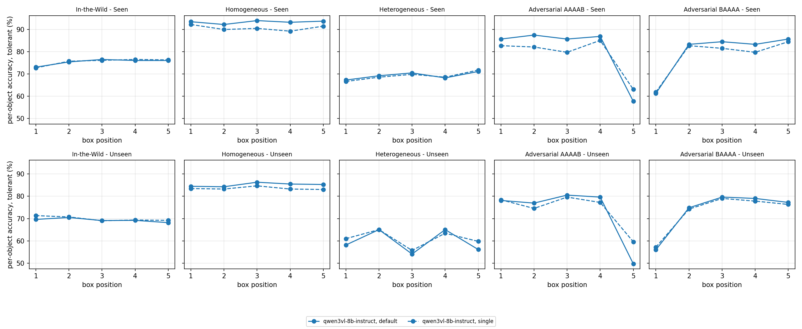

# RQ1 run: qwen3vl-8b-instruct

This folder holds the finished RQ1 run of Qwen3-VL-8B-Instruct (`qwen3vl-8b-instruct`) on all 5,163 ROPE items, with both probes: `default` (all five boxes in one answer) and `single` (one box per call). Decoding is greedy. Split `train` is Seen and `validation` is Unseen. Every number below comes from the files in this folder.

## Files

| file | contents | rows | size |
|---|---|---|---|
| `rq1_qwen3vl-8b-instruct_default_train.jsonl` | default, Seen, subsets `heterogenous` `homogenous` `mixed` | 2,251 | 3.8 MB |
| `rq1_qwen3vl-8b-instruct_default_validation.jsonl` | default, Unseen, the same three subsets | 1,908 | 3.3 MB |
| `rq1_qwen3vl-8b-instruct_single_train.jsonl` | single, Seen, the same three subsets | 2,251 | 4.2 MB |
| `rq1_qwen3vl-8b-instruct_single_validation.jsonl` | single, Unseen, the same three subsets | 1,908 | 3.6 MB |
| `rq1_qwen3vl-8b-instruct_adversarial_default_train.jsonl` | default, Seen, subsets `AAAAB` `BAAAA` | 336 | 0.6 MB |
| `rq1_qwen3vl-8b-instruct_adversarial_default_validation.jsonl` | default, Unseen, `AAAAB` `BAAAA` | 668 | 1.1 MB |
| `rq1_qwen3vl-8b-instruct_adversarial_single_train.jsonl` | single, Seen, `AAAAB` `BAAAA` | 336 | 0.6 MB |
| `rq1_qwen3vl-8b-instruct_adversarial_single_validation.jsonl` | single, Unseen, `AAAAB` `BAAAA` | 668 | 1.2 MB |
| `rq1_table1.csv` | Table 1, one line per subset x probe x split | 24 | |
| `rq1_fig1_position.png` | accuracy by box position (Figure 1) | | |
| `rq1_parser_audit.jsonl` | hand check of 200 rows: key, verdict, note | 200 | |

Subset names are moh's folder names: `mixed` is In-the-Wild, `homogenous` is Homogeneous, `heterogenous` is Heterogeneous, and Adversarial is `AAAAB` plus `BAAAA` (502 images, each in both orders). The row format is the JSONL schema in `harness/README.md`. `image_path` and `model_path` are written relative to `$CSE595_ROOT` (the folder that holds `data/ROPE/` and `models/`, see `harness/README.md`).

The tables, CSV and figure are produced by `analysis/rq1_table.py`:

```bash
source harness/env.sh
python analysis/rq1_table.py --out-dir results/qwen3vl-8b-instruct results/qwen3vl-8b-instruct/rq1_*.jsonl
```

## How the runs were made

All eight jobs ran on Great Lakes under account `cse595f26_class`, with vLLM 0.11.0, transformers 4.57.6, torch 2.8.0 and qwen-vl-utils 0.0.14 (Python 3.11.5), model revision `0c351dd01ed87e9c1b53cbc748cba10e6187ff3b`, `max_tokens` 1024 and `max_model_len` 12288. Each job ran, for each probe, `python -m rope_runner.run --model qwen3vl-8b-instruct --probe <probe> --split <split> --subset <subsets> --greedy --chunk 256 --prefix-caching <auto|off> --out <file> --resume`. Prefix caching was `auto` for default and `off` for single.

| job | probe | split | subsets | GPU | elapsed |
|---|---|---|---|---|---|
| 65875333 | default | train | heterogenous homogenous mixed | A100 80GB MIG 3g.40gb (gpu_mig40) | 15:17 |
| 65875334 | default | validation | heterogenous homogenous mixed | A100 80GB MIG 3g.40gb (gpu_mig40) | 12:15 |
| 65875340 | single | train | heterogenous homogenous mixed | A100 80GB MIG 3g.40gb (gpu_mig40) | 22:29 |
| 65875341 | single | validation | heterogenous homogenous mixed | A100 80GB MIG 3g.40gb (gpu_mig40) | 19:34 |
| 65407619 | default | train | AAAAB BAAAA | A40 (spgpu) | 3:37 |
| 65407618 | default | validation | AAAAB BAAAA | A40 (spgpu) | 6:13 |
| 65407623 | single | train | AAAAB BAAAA | A40 (spgpu) | 4:45 |
| 65407622 | single | validation | AAAAB BAAAA | A40 (spgpu) | 6:48 |

This command reproduces a run with this repository's harness (here single on Seen; change `SPLIT`, `PROBES` and `SUBSETS` for the others, and use `--prefix-caching auto` for default):

```bash
sbatch -A "$CSE595_ACCOUNT" -o "$CSE595_LOGS/%x-%j.out" -e "$CSE595_LOGS/%x-%j.err" \
  --export=ALL,MODEL=qwen3vl-8b-instruct,SPLIT=train,PROBES=single,SUBSETS="heterogenous homogenous mixed",EXTRA="--chunk 256 --prefix-caching off",OUT=$CSE595_RUNS/rq1_qwen3vl-8b-instruct_single_train.jsonl \
  harness/scripts/run.sbatch
```

## Integrity

Every file has exactly one row per entry of the ROPE JSON for its subset and split (Seen: 312 / 400 / 1,539 for heterogenous / homogenous / mixed, 168 + 168 Adversarial; Unseen: 246 / 490 / 1,172, 334 + 334) and no duplicate keys. Four default Unseen rows (three In-the-Wild, one Heterogeneous) hit the 1,024-token limit. In each of them the model repeats class names until it is cut off. No single call hit the limit.

## Scoring

Tolerant parse is the main number and strict (moh's official parser) is shown beside it. A call that hits the token limit makes every object it answers wrong (default: all five objects of the image; single: the object of that call), and those objects stay in the denominator. In this run that rule turns one object from correct to wrong (validation, `mixed`, entry 254, box 1). Accuracy is correct boxes over scored boxes. CIs are 95% percentile bootstraps over images (2,000 reps).

## Table 1: per-object accuracy (%)

| subset | probe | split | n images | n objects | calls at limit | tolerant [95% CI] | strict [95% CI] |
|---|---|---|---|---|---|---|---|
| In-the-Wild | default | Seen | 1,539 | 7,695 | 0 | 75.5 [74.3, 76.6] | 75.4 [74.2, 76.6] |
| In-the-Wild | default | Unseen | 1,172 | 5,860 | 3 | 69.3 [67.8, 70.8] | 68.5 [67.0, 70.0] |
| In-the-Wild | single | Seen | 1,539 | 7,695 | 0 | 75.5 [74.4, 76.7] | 75.5 [74.3, 76.7] |
| In-the-Wild | single | Unseen | 1,172 | 5,860 | 0 | 69.9 [68.5, 71.3] | 69.9 [68.6, 71.3] |
| Homogeneous | default | Seen | 400 | 2,000 | 0 | 93.3 [91.1, 95.5] | 93.3 [91.1, 95.5] |
| Homogeneous | default | Unseen | 490 | 2,450 | 0 | 85.2 [82.2, 88.0] | 85.2 [82.2, 88.0] |
| Homogeneous | single | Seen | 400 | 2,000 | 0 | 90.7 [88.4, 92.9] | 90.7 [88.3, 92.9] |
| Homogeneous | single | Unseen | 490 | 2,450 | 0 | 83.6 [80.8, 86.4] | 83.6 [80.7, 86.2] |
| Heterogeneous | default | Seen | 312 | 1,560 | 0 | 69.3 [67.1, 71.5] | 68.8 [66.3, 71.1] |
| Heterogeneous | default | Unseen | 246 | 1,230 | 1 | 59.7 [56.9, 62.7] | 59.1 [56.1, 61.9] |
| Heterogeneous | single | Seen | 312 | 1,560 | 0 | 69.1 [66.8, 71.3] | 69.1 [66.9, 71.5] |
| Heterogeneous | single | Unseen | 246 | 1,230 | 0 | 61.0 [58.4, 63.5] | 61.0 [58.3, 63.5] |
| Adversarial | default | Seen | 336 | 1,680 | 0 | 80.2 [77.2, 82.8] | 79.9 [76.9, 82.7] |
| Adversarial | default | Unseen | 668 | 3,340 | 0 | 73.2 [70.8, 75.4] | 72.9 [70.6, 75.2] |
| Adversarial | single | Seen | 336 | 1,680 | 0 | 78.3 [75.5, 81.2] | 78.3 [75.4, 81.1] |
| Adversarial | single | Unseen | 668 | 3,340 | 0 | 73.4 [71.1, 75.7] | 73.4 [71.0, 75.6] |

`rq1_table1.csv` also has each Adversarial order separately, the tolerant accuracy with cut rows dropped, and the parse-failure rates.

## Single vs default on the same images

The paired unit is the box, on images matched on (split, subset, entry_idx, image_id). p is an exact McNemar test on discordant boxes (it treats the five boxes of an image as independent); b counts boxes right only under single and c boxes right only under default. The CI is a paired bootstrap over images. Holm runs over the 8 rows, separately per parser. Differences are default minus single, in points.

| subset | split | n images | tolerant single -> default | diff [95% CI] | b / c | p | Holm p | strict diff, Holm p |
|---|---|---|---|---|---|---|---|---|
| In-the-Wild | Seen | 1,539 | 75.5 -> 75.5 | -0.1 [-0.8, +0.6] | 314 / 309 | 0.87 | 1 | -0.1, 1 |
| In-the-Wild | Unseen | 1,172 | 69.9 -> 69.3 | -0.6 [-1.5, +0.2] | 269 / 233 | 0.12 | 0.59 | -1.4, 0.003 |
| Homogeneous | Seen | 400 | 90.7 -> 93.4 | +2.6 [+1.4, +4.0] | 16 / 69 | 5.2e-9 | 4.2e-8 | +2.6, 4.2e-8 |
| Homogeneous | Unseen | 490 | 83.6 -> 85.2 | +1.6 [+0.6, +2.7] | 30 / 70 | 7.9e-5 | 5.5e-4 | +1.6, 5.5e-4 |
| Heterogeneous | Seen | 312 | 69.1 -> 69.3 | +0.2 [-1.3, +1.9] | 69 / 72 | 0.87 | 1 | -0.3, 1 |
| Heterogeneous | Unseen | 246 | 61.0 -> 59.7 | -1.3 [-3.0, +0.4] | 72 / 56 | 0.19 | 0.74 | -1.9, 0.23 |
| Adversarial | Seen | 336 | 78.3 -> 80.2 | +1.8 [+0.2, +3.5] | 47 / 78 | 0.007 | 0.042 | +1.6, 0.11 |
| Adversarial | Unseen | 668 | 73.4 -> 73.2 | -0.2 [-1.4, +0.8] | 131 / 123 | 0.66 | 1 | -0.5, 0.97 |

Under the tolerant parse, default is better than single on Homogeneous (+2.6 Seen, +1.6 Unseen) and on Adversarial Seen (+1.8, Holm p = 0.042). The other cells differ by less than 1.5 points with Holm p above 0.5. Under the strict parse, In-the-Wild Unseen also comes out lower for default (-1.4, Holm p = 0.003). The extra strict loss there comes from default answers the strict parser cannot read, listed under the parser audit.

## Seen vs Unseen

Seen and Unseen use different images and different candidate lists, so the comparison is unpaired. The gap is Unseen minus Seen in points. The CI resamples each split's images separately; p is a two-sided permutation test (10,000 reps, so the smallest possible p is about 1e-4); Holm runs over the 8 rows.

| subset | probe | n Seen / Unseen | tolerant Seen -> Unseen | gap [95% CI] | p | Holm p | strict gap |
|---|---|---|---|---|---|---|---|
| In-the-Wild | default | 1,539 / 1,172 | 75.5 -> 69.3 | -6.1 [-8.0, -4.3] | 1e-4 | 8e-4 | -6.9 |
| In-the-Wild | single | 1,539 / 1,172 | 75.5 -> 69.9 | -5.6 [-7.5, -3.8] | 1e-4 | 8e-4 | -5.6 |
| Homogeneous | default | 400 / 490 | 93.3 -> 85.2 | -8.2 [-11.8, -4.7] | 1e-4 | 8e-4 | -8.2 |
| Homogeneous | single | 400 / 490 | 90.7 -> 83.6 | -7.1 [-10.7, -3.5] | 5e-4 | 0.0012 | -7.1 |
| Heterogeneous | default | 312 / 246 | 69.3 -> 59.7 | -9.6 [-13.6, -5.8] | 1e-4 | 8e-4 | -9.7 |
| Heterogeneous | single | 312 / 246 | 69.1 -> 61.0 | -8.1 [-11.7, -4.8] | 1e-4 | 8e-4 | -8.1 |
| Adversarial | default | 336 / 668 | 80.2 -> 73.2 | -7.0 [-10.6, -3.6] | 4e-4 | 0.0012 | -7.0 |
| Adversarial | single | 336 / 668 | 78.3 -> 73.4 | -4.9 [-8.5, -1.2] | 0.012 | 0.012 | -4.9 |

Unseen accuracy is lower in every subset and for both probes, by 4.9 to 9.6 points.

## Accuracy by box position



Tolerant accuracy (%) at boxes 1 to 5:

| subset | probe | split | box 1 | box 2 | box 3 | box 4 | box 5 |
|---|---|---|---|---|---|---|---|
| In-the-Wild | default | Seen | 73.1 | 75.4 | 76.5 | 76.1 | 76.1 |
| In-the-Wild | default | Unseen | 69.6 | 70.5 | 69.1 | 69.2 | 68.2 |
| In-the-Wild | single | Seen | 72.8 | 75.8 | 76.2 | 76.5 | 76.3 |
| In-the-Wild | single | Unseen | 71.3 | 70.7 | 69.0 | 69.4 | 69.2 |
| Homogeneous | default | Seen | 93.5 | 92.2 | 94.0 | 93.2 | 93.8 |
| Homogeneous | default | Unseen | 84.5 | 84.3 | 86.3 | 85.5 | 85.3 |
| Homogeneous | single | Seen | 92.2 | 90.0 | 90.5 | 89.2 | 91.5 |
| Homogeneous | single | Unseen | 83.5 | 83.3 | 84.7 | 83.3 | 83.1 |
| Heterogeneous | default | Seen | 67.3 | 69.2 | 70.5 | 68.3 | 71.2 |
| Heterogeneous | default | Unseen | 58.1 | 65.0 | 54.1 | 65.0 | 56.1 |
| Heterogeneous | single | Seen | 66.7 | 68.6 | 69.9 | 68.6 | 71.8 |
| Heterogeneous | single | Unseen | 61.0 | 65.0 | 55.7 | 63.4 | 59.8 |
| Adversarial AAAAB | default | Seen | 85.7 | 87.5 | 85.7 | 86.9 | 57.7 |
| Adversarial AAAAB | default | Unseen | 78.1 | 76.9 | 80.5 | 79.6 | 49.7 |
| Adversarial AAAAB | single | Seen | 82.7 | 82.1 | 79.8 | 85.1 | 63.1 |
| Adversarial AAAAB | single | Unseen | 78.4 | 74.6 | 79.6 | 77.2 | 59.6 |
| Adversarial BAAAA | default | Seen | 61.3 | 83.3 | 84.5 | 83.3 | 85.7 |
| Adversarial BAAAA | default | Unseen | 56.0 | 74.9 | 79.6 | 79.0 | 77.2 |
| Adversarial BAAAA | single | Seen | 61.9 | 82.7 | 81.5 | 79.8 | 84.5 |
| Adversarial BAAAA | single | Unseen | 57.2 | 74.3 | 79.0 | 77.8 | 76.3 |

Strict values are in the script's output. They differ from these by at most 1.0 point, in default rows only. On In-the-Wild and Homogeneous the five positions are within 3.7 points of each other. On Adversarial the odd box (box 5 in AAAAB, box 1 in BAAAA) is 15 to 31 points below the other four, under both probes.

## Parser audit

We drew 200 rows of the four `heterogenous` / `homogenous` / `mixed` files (seed 0, 16 or 17 from each subset x probe x split cell; 1,000 objects) and read every raw answer. `rq1_parser_audit.jsonl` has the verdict for each.

| check | rows | Wilson 95% |
|---|---|---|
| tolerant label differs from what the answer says | 0 / 200 (0 / 1,000 objects) | 0.0 to 1.9% (objects: 0.00 to 0.38%) |
| strict fails only because of the answer's format | 0 / 200 | 0.0 to 1.9% |
| the answer names a class outside the candidate list (`lime`, `grape`, `lemon`, `wall`); both parsers keep it and score it wrong | 4 / 200 | 0.8 to 5.0% |

The sample has no row where strict and tolerant disagree, so we also read every such row in the four files. There are 23, all `default`, covering 94 objects; on 63 of them tolerant is right and strict is wrong. Single answers are bare class names and the two parsers agree on all of them.

| kind | rows (split, subset, entry_idx) | what the parsers do |
|---|---|---|
| one `objK: label` per line instead of a comma list | train heterogenous 130; validation mixed 1070 | tolerant reads the labels correctly; strict reads nothing (format only) |
| several classes listed for one box, e.g. `obj1: window, balcony, shutter` | train heterogenous 236; validation heterogenous 3, 90; validation mixed 12, 45, 104, 176, 253, 280, 307, 439, 501, 522, 574, 605, 616 | tolerant takes the first class listed for each box, which earns credit when that class is the gold one; strict gives no label |
| class names repeated until the token limit | validation heterogenous 118; validation mixed 254, 346, 650 | tolerant reads the first class of box 1; all objects are scored wrong by the token-limit rule |
| `fire truck` for a gold `truck` | train mixed 953 | tolerant maps it to the candidate `truck` and scores it right; strict keeps `fire truck` and scores it wrong |

Taking the first of several listed classes is the tolerant parser's choice for answers that do not commit to one class. It affects 16 rows, all in `default` answers on In-the-Wild and Heterogeneous.
